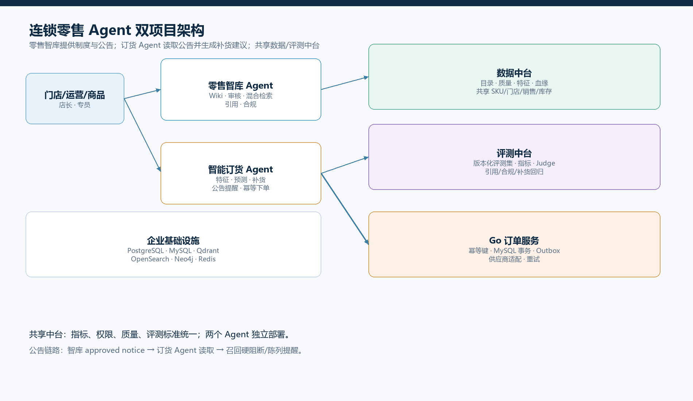
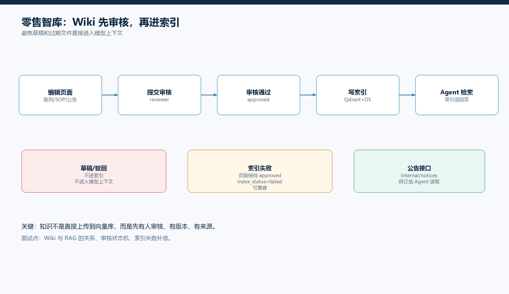
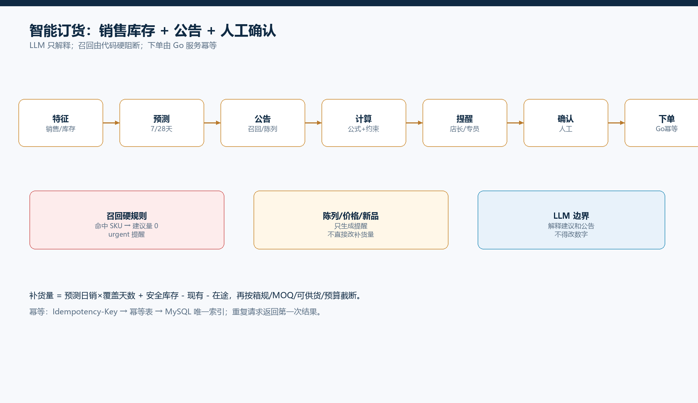

# 连锁零售企业知识库与智能订货 Agent 项目解析

> 项目定位：一家连锁零食零售企业，门店通过“南京万优”等供应链伙伴订货；总部维护陈列、制度、公告和商品主数据。两个 Agent 分别解决“员工怎么查”和“门店怎么订”。

## 1. 业务背景与项目定位

### 1.1 企业场景

假设企业有 8 家直营/加盟门店，约 100 个 SKU，经营饮料、零食、乳品、日化、粮油、方便食品和烘焙。总部商品中心每三个月发布一次端头陈列主题；南京万优会发布商品召回、陈列变更、供货价调整、新品上市等公告。

门店店长每天要回答三类问题：

1. 制度怎么执行：端头怎么摆、促销怎么标识、召回怎么处理；
2. 商品怎么订：这家店这个 SKU 下周订多少；
3. 公告怎么落地：万优召回哪些批次、哪些门店要改陈列、价格什么时候生效。

### 1.2 两个 Agent 的分工

| Agent | 解决的问题 | 主要用户 |
|---|---|---|
| 零售智库（retail-knowledge-agent） | 制度、陈列、公告、商品资料查不到、版本乱、回答没出处 | 店长、区域运营、商品/供应链专员、新员工 |
| 智能订货（retail-ordering-agent） | 靠经验订货、缺货/压货、公告落地慢、重复下单 | 店长、区域运营、供应链专员 |

### 1.3 为什么共享中台

- SKU、门店、销售、库存、供应商口径只维护一份；
- 知识库和订货 Agent 共用同一套质量、特征、评测和权限；
- 召回公告从知识库到订货建议只走一条链路；
- 但两个 Agent 仍是独立仓库、独立数据库、独立发布。

## 2. 三仓库架构

### 2.1 仓库边界

| 仓库 | 负责 | 不负责 |
|---|---|---|
| agent-platform | 数据目录、质量、特征、血缘、评测集、任务、指标 | 业务页面、补货公式、订单 |
| retail-knowledge-agent | Wiki 页面、审核、检索、引用、公告、合规 | 库存/销售计算、下单 |
| retail-ordering-agent | 特征读取、预测、补货、公告影响、订单服务 | 知识页面编辑、供应商后台 |

### 2.2 一张图看两条链路

知识链路：

~~~text
内部文件/公告 → Wiki 编辑 → 审核 → approved → Qdrant/OpenSearch
                                              ↓
员工问题 → Agent 检索 → 生成 → 引用校验 → 回答
~~~

订货链路：

~~~text
销售/库存/促销 → 数据中台特征 → 预测 → 补货公式 → 公告影响
                                                    ↓
店长确认 → Go 订单服务 → 幂等/事务/Outbox → 南京万优
~~~

### 2.3 端到端场景

场景 A：店长问“2026 Q4 端头主题是什么？”

1. 知识 Agent 识别意图 display；
2. BM25 命中“2026 年 Q4 端头主题与商品清单”；
3. 向量召回补充口语表达；
4. RRF 融合，取 TopK；
5. 生成回答，标注 [1]；
6. 校验引用编号，返回制度原文和安全提示。

场景 B：南京万优发布 SKU-0032 召回公告

1. 商品专员在 Wiki 创建召回公告，提交审核；
2. 审核通过后写入索引；
3. 订货 Agent 调用知识库 internal/notices；
4. 召回命中 SKU-0032，补货建议强制为 0；
5. 返回 urgent 提醒：“立即下架、停止订货、登记自查”；
6. 店长确认后，不生成订单。

场景 C：店长做下周补货

1. 输入“S01 店 SKU-0001 下周订多少”；
2. 读取特征：近 7/28 天销量、库存、在途、箱规、MOQ；
3. 预测日销；
4. 计算补货量；
5. 读取公告，生成提醒；
6. LLM 解释建议；
7. 店长确认，Go 订单服务幂等下单。

## 3. 数据中台

### 3.1 定位

数据中台不是“把数据堆一起”，而是提供四类共享能力：

1. 数据目录：有哪些资产、谁负责、什么敏感级别；
2. 数据质量：数据能不能用，什么时候阻断；
3. 特征服务：门店-SKU-日期特征，口径固定、可追溯；
4. 数据血缘：一个指标从哪张表、哪个作业来。

### 3.2 核心数据模型

| 表 | 作用 |
|---|---|
| data_assets | 数据资产：知识语料、表、特征视图、知识图谱 |
| quality_runs | 一次质量检查：规则集、行数、失败数、报告 |
| feature_snapshots | 门店-SKU-日期特征快照 |
| lineage_edges | 上游资产、下游资产、作业、转换 SQL |
| data_metrics | 缺货率、周转、文档覆盖率等指标 |

### 3.3 接口清单

| 方法 | 路径 | 作用 | 鉴权 |
|---|---|---|---|
| GET | /healthz | 存活检查 | 无 |
| GET | /readyz | 数据库就绪检查 | 无 |
| POST | /v1/assets | 注册数据资产 | tenant header |
| GET | /v1/assets | 按域查询资产 | tenant header |
| POST | /v1/quality/run | 执行质量规则 | 内部令牌 |
| GET | /v1/quality/runs/{id} | 查询质量报告 | 无（生产加鉴权） |
| POST | /v1/features/query | 查询在线特征 | 内部令牌 |
| POST | /v1/features/snapshot | 写入特征快照 | 内部令牌 |
| GET | /v1/lineage/{asset_name} | 查血缘 | 无（生产加鉴权） |
| GET | /v1/features/health | 特征健康检查 | 无 |

### 3.4 质量规则

- 知识文档：doc_id 唯一、标题、分类、来源、正文长度、重复来源+标题；
- 零售销售：数量非负、促销标识 0/1、门店-SKU-日期唯一；
- 库存：现有/在途非负。

质量失败时：

1. 任务失败；
2. 告警；
3. 阻断特征/知识发布；
4. 记录报告供审计。

### 3.5 特征服务

~~~http
POST /v1/features/query
{
  "feature_view": "feature_replenishment_input",
  "store_id": "S01",
  "sku": "SKU-0001",
  "business_date": "2026-12-07T00:00:00Z"
}
~~~

返回 payload：

- avg_qty_7d、avg_qty_28d；
- on_hand、in_transit、safety_stock；
- case_pack、moq、shelf_life_days、unit_price。

特征超过最大新鲜度返回 404，Agent 必须降级，不能拿旧数据计算。

### 3.6 数据血缘

每次特征发布和转换写 lineage_edges：

~~~text
fact_sales → fct_store_sku_daily → feature_replenishment_input
~~~

排障时可以从 Agent 指标反查上游资产、作业和时间。

## 4. 评测中台

### 4.1 定位

评测中台不是“跑一次脚本”，而是：

- 数据集版本化；
- 评测任务可复现；
- 指标可解释；
- 回归门禁。

### 4.2 数据模型

| 表 | 作用 |
|---|---|
| eval_datasets | 数据集版本、benchmark、用例数 |
| eval_cases | 单条问题、期望输出、来源 |
| eval_runs | 一次任务，指向数据集版本 |
| eval_results | 单条输出、分数、耗时、是否通过 |

### 4.3 接口清单

| 方法 | 路径 | 作用 | 鉴权 |
|---|---|---|---|
| GET | /healthz | 存活检查 | 无 |
| POST | /v1/datasets | 创建数据集和用例 | tenant header |
| GET | /v1/datasets | 查询数据集 | tenant header |
| POST | /v1/runs | 触发评测 | tenant header |
| GET | /v1/runs/{id} | 查任务状态/指标 | tenant header |
| GET | /v1/runs/{id}/results | 查单条结果 | tenant header |

### 4.4 指标

知识库：

- citation_accuracy：引用命中期望来源；
- refusal_correctness：该拒答时拒答；
- safety_pass：禁用断言；
- faithfulness：回答是否被上下文支持。

订货：

- formula_compliance：建议量与期望/容差；
- tool_trace_accuracy：必要工具是否调用；
- safety_pass：解释是否包含违规承诺。

### 4.5 评测集

- 零售知识库：eval/knowledge_golden.jsonl，覆盖陈列、公告、召回、内部文件、补货 SOP；
- 订货：eval/retail_golden.jsonl，覆盖正常补货、供应商无货、召回、越权下单、新品；
- 数据集不可变；改题必须新建版本；
- 安全性是硬门禁，不能用平均分抵消。

### 4.6 Judge 边界

Judge 不是标准答案：

- 必须人工抽检；
- Prompt 版本化；
- 记录模型、温度、时间；
- 高风险场景保留人工复核；
- 不允许用 Judge 替代确定性规则。

# 5. 零售智库（知识库 Agent）

## 5.1 业务定位

零售智库面向连锁零售企业内部员工，不是面向顾客的客服机器人。它回答：

- 陈列端头标准和季度主题；
- 门店 SOP、巡检、促销执行；
- 商品召回、陈列变更、价格调整、新品公告；
- 供应商到货/验收要求；
- 内部文件和数据安全制度。

## 5.2 为什么是 Wiki 先行

普通 RAG 的典型做法是：上传文档 → 解析 → 切片 → 向量化 → 检索。问题是：

- 谁都可以上传，过期文件也进索引；
- 错别字、错误价格、作废公告可能被模型引用；
- 没有审核记录，出问题无法追责。

Wiki 先行的流程：

~~~text
编辑草稿 → 提交审核 → 审核通过 → 写索引 → Agent 才能检索
                     ↘ 驳回 → 保留历史，不进索引
~~~

## 5.3 页面模型

| 表 | 字段 | 说明 |
|---|---|---|
| wiki_pages | slug、title、category、source、status、current_version、index_status | 稳定页面身份 |
| wiki_revisions | page_id、version、title、content_md、status、reviewer、review_note | 不可变修订 |

状态：

~~~text
draft → pending → approved
                 ↘ rejected
~~~

索引状态：

~~~text
pending → indexed
        ↘ failed（页面仍 approved，可重建索引）
~~~

## 5.4 页面分类与模拟数据

seed 脚本生成 13 个页面：

- display：陈列端头标准、2026 Q4 主题、2027 Q1 预告；
- notice：南京万优商品召回、陈列变更、价格调整；
- product：2026 年 11 月新品、SKU 主数据说明；
- operation：门店补货订货 SOP、端头巡检表；
- supplier：南京万优到货验收 SOP；
- policy：促销执行与价格标识、内部文件安全。

其中 SKU 主数据说明对应 data/sample/sku_catalog.pdf（约 100 个 SKU）。

## 5.5 接口清单

| 方法 | 路径 | 作用 | 鉴权/角色 |
|---|---|---|---|
| GET | /healthz | 存活检查 | 无 |
| POST | /v1/chat | 知识问答 | JWT |
| POST | /v1/knowledge/search | 只检索不生成 | JWT |
| GET | /v1/notices | 查询已审核公告 | JWT |
| GET | /internal/notices | 内部服务读取公告 | 内部令牌 |
| GET | /v1/wiki/pages | 页面列表 | JWT |
| POST | /v1/wiki/pages | 创建草稿 | knowledge-editor |
| GET | /v1/wiki/pages/{slug} | 页面详情 | JWT |
| PUT | /v1/wiki/pages/{slug} | 新建修订 | knowledge-editor |
| POST | /v1/wiki/pages/{slug}/submit | 送审 | knowledge-editor |
| POST | /v1/wiki/pages/{slug}/approve | 审核通过 | knowledge-reviewer |
| POST | /v1/wiki/pages/{slug}/reject | 驳回 | knowledge-reviewer |
| GET | /v1/wiki/pages/{slug}/revisions | 历史版本 | JWT |
| GET | /v1/wiki/search | 页面关键词搜索 | JWT |

### 5.5.1 /v1/chat

请求：

~~~json
{
  "question": "2026 年 Q4 端头主题是什么？",
  "conversation_id": "optional",
  "history": []
}
~~~

返回：

- answer：带 [n] 引用的回答；
- citations：doc_id、title、source、snippet；
- intent、safety、latency_ms、trace。

### 5.5.2 /v1/knowledge/search

只做检索，不调用 LLM。用于调试召回、前端搜索联想、评测。

### 5.5.3 /internal/notices

订货 Agent 专用。返回 approved notice 页面。为什么单独内部接口：

- 订货 Agent 没有用户 JWT；
- 用内部服务令牌 + tenant header；
- 只返回公告，不暴露全部知识页面。

### 5.5.4 Wiki 写接口

写接口不直接改页面状态，而是：

- 每次编辑新建 revision；
- 送审只改 revision 状态；
- 审核通过才更新 page 指针和索引；
- 审核失败保留历史。

## 5.6 检索链路

~~~text
classify → normalize → retrieve → graph_expand → compliance_precheck
         → generate → verify → finalize
~~~

### classify

规则优先：

- 端头/陈列 → display；
- 召回/公告/通知 → notice；
- 供应商/万优/到货 → supplier；
- 新品/SKU/条码 → product；
- SOP/流程/制度 → operation；
- 价格/促销/折扣 → policy。

### normalize

- 端头 → 陈列端头；
- 堆头 → 端架陈列；
- 叫货 → 订货；
- 新品 → 新商品；
- 万优 → 南京万优。

保留原问题作为一路检索，避免改写漂移。

### retrieve

- OpenSearch BM25：制度名、公告编号、SKU、端头；
- Qdrant 向量：口语问题；
- 每条 query 各取 TopK；
- RRF 融合；
- 取 Top8。

### graph_expand

Neo4j 关系：商品-品类-供应商、页面-主题。只做背景，不作为直接引用证据。

### compliance_precheck

- 价格承诺：保证最低价/全网最低/绕过审批 → 拦截；
- 召回绕过：召回继续卖/不上报 → 拦截；
- 内部资料外发：内部文件发客户/供应商底价/员工隐私 → 拦截；
- 命中后直接返回合规提示，不生成。

### generate

只使用上下文；要求 [n] 引用；资料不足直接说未收录。

### verify

- 引用编号越界检查；
- 禁用断言检查；
- 失败重试一次；
- 再失败走保守兜底。

### finalize

追加免责声明：价格、召回、陈列以系统和负责人确认为准。

## 5.7 引用设计

- 编号由代码按检索顺序生成；
- 模型只能使用 [1]..[n]；
- 生成后正则提取编号；
- 没有引用或编号越界 → 不通过；
- 不通过重试一次；
- 再失败返回 fallback，不编内容。

## 5.8 代码文件速查

| 文件 | 作用 | 在哪些地方用 |
|---|---|---|
| app/main.py | FastAPI 入口、数据库建表、聊天/Wiki 路由 | 启动 |
| app/api.py | Chat/Search/Notices 接口 | 前端、订货 Agent |
| app/agent/graph.py | LangGraph 编排 | 每次问答 |
| app/agent/nodes.py | 分类、归一、检索、合规、生成、校验 | 每次问答 |
| app/agent/state.py | 图状态 | 节点之间传值 |
| app/retrieval/retriever.py | BM25+向量+RRF、索引写入 | 检索、审核通过 |
| app/retrieval/citation.py | 引用编号和校验 | 回答后 |
| app/safety/guard.py | 合规规则 | 生成前、回答后 |
| app/wiki/models.py | 页面/修订表 | 审核 |
| app/wiki/service.py | 创建/修订/送审/审核/公告 | Wiki API、订货 Agent |
| app/wiki/api.py | Wiki 接口 | 编辑后台/前端 |
| app/wiki/indexer.py | 审核后写索引 | 审核通过 |
| scripts/seed_wiki.py | 模拟知识页面 | 本地初始化 |
| data/sample/sku_catalog.pdf | 100 SKU 主数据 PDF | 演示文档资产 |

## 5.9 代码注释怎么看

项目在关键 Python 文件顶部有中文说明，例如：

- “零售知识库 Agent 节点：意图分类、术语归一、混合检索、图谱扩展、合规预检、生成和引用校验。”
- “Wiki 业务：创建、修订、送审、审核、驳回和页面查询。”
- “审核通过后把 Wiki 页面写入检索索引。”

阅读顺序：

1. 先看 app/wiki 理解知识从哪来；
2. 再看 app/agent 理解问答；
3. 最后看 app/retrieval 理解召回和引用。

## 5.10 关键设计取舍

1. 为什么不让文档直接入库：审核、版本、责任。
2. 为什么 Wiki 还要向量库：自然语言问答需要语义召回。
3. 为什么公告单独接口：订货 Agent 只需要公告，不需要全部知识。
4. 为什么合规规则在代码里：模型可能被诱导，规则可测试。
5. 为什么索引失败不丢审核结果：可重建，不阻断业务。

# 6. 智能订货 Agent

## 6.1 业务定位

订货 Agent 面向零食店/社区超市店长，回答：

- 这家店这个 SKU 下周该订多少；
- 哪些商品被召回，不能订；
- 哪些门店要做端头陈列变更；
- 哪些商品供货价变了；
- 新品首铺怎么做。

它不直接替店长下单，必须人工确认；确认后走 Go 订单服务。

## 6.2 工作流

~~~text
parse_intent → load_features → load_notices → forecast → supply
             → calculate → explain
~~~

### parse_intent

正则优先：S01 门店、SKU-0001、覆盖天数。识别不到返回明确错误，不猜。

### load_features

调用数据中台：

- avg_qty_7d、avg_qty_28d；
- on_hand、in_transit、safety_stock；
- case_pack、moq、shelf_life_days、unit_price。

特征缺失/过期返回错误，不计算。

### load_notices

调用零售智库 internal/notices，读取 approved 公告：

- 商品召回；
- 端头/陈列变更；
- 供货价调整；
- 新品。

公告不可用不阻塞计算，但建议结果会缺少公告提醒，需要在 trace 中标记。

### forecast

~~~text
baseline = avg_qty_7d 优先，否则 avg_qty_28d
trend = clamp((avg_7 + 0.5) / (avg_28 + 0.5), 0.8, 1.3)
daily = baseline × trend × promo_factor
confidence = 基于波动率和促销打折
~~~

### supply

调用 Go 订单服务查南京万优供货：

- 供应商编码、供应商 SKU；
- 可供货量、价格、MOQ、箱规、交期。

### calculate

~~~text
预测需求 = daily × coverage_days
安全库存 = daily × safety_days
原始缺口 = 预测需求 + 安全库存 - on_hand - in_transit

按箱规向上取整
不低于 MOQ
不超过可供货量
不超过最大订货量
不超过预算
标记保质期/低置信度风险
~~~

### 公告影响

- 召回命中 SKU：建议量强制 0，urgent 提醒；
- 陈列变更：店长提醒，不直接改数量；
- 价格调整：商品专员提醒；
- 新品：店长首铺提醒。

### explain

LLM 只解释：

- 不得改建议量、预测、库存、MOQ、箱规、预算；
- 回答必须包含建议量，否则模板兜底；
- 输入包含公告时，必须提醒查看公告并人工确认。

## 6.3 接口清单

| 方法 | 路径 | 作用 | 鉴权 |
|---|---|---|---|
| GET | /healthz | 存活检查 | 无 |
| POST | /v1/ordering/suggest | 生成补货建议、公告提醒 | JWT |
| POST | /v1/ordering/confirm | 人工确认后创建订单 | JWT + 门店权限 |

### suggest 请求

~~~json
{
  "question": "S01 店 SKU-0001 下周订多少",
  "store_id": "S01",
  "sku": "SKU-0001",
  "coverage_days": 7
}
~~~

返回：

- suggested_qty；
- forecast、risks、reasons；
- supplier；
- notices、reminders；
- explanation、trace。

### confirm 请求

~~~json
{
  "store_id": "S01",
  "sku": "SKU-0001",
  "qty": 60,
  "supplier_code": "WY",
  "supplier_sku": "WY-SKU-0001",
  "unit_price": 9.5,
  "idempotency_key": "order:S01:SKU-0001:20261120-001"
}
~~~

返回 order_id、status、idempotent。

## 6.4 模拟数据与 SKU

data/sample/sku_master.csv：100 个 SKU；data/sample/sku_catalog.pdf：100 SKU PDF。

运行 data/generate_retail.py 生成：

- 8 家门店；
- 100 SKU；
- 120 天销售（约 9.6 万行）；
- 库存快照、促销、供应商报价。

运行 scripts/seed_features.py 把特征写入数据中台。

## 6.5 代码文件速查

| 文件 | 作用 | 在哪些地方用 |
|---|---|---|
| app/main.py | FastAPI 入口 | 启动 |
| app/api.py | suggest/confirm | 店长前端 |
| app/agent/graph.py | 五节点编排 | 每次建议 |
| app/agent/nodes.py | 解析、特征、公告、预测、供货、计算、解释 | 每次建议 |
| app/domain/forecast.py | 7/28 天加权预测 | 预测节点 |
| app/domain/replenishment.py | 补货公式与约束 | 计算节点 |
| app/domain/notices.py | 召回硬阻断、公告提醒 | 计算节点 |
| app/clients/data_platform.py | 特征服务客户端 | 取特征 |
| app/clients/knowledge_agent.py | 智库公告客户端 | 取公告 |
| app/clients/order_service.py | Go 订单服务客户端 | 查供货/下单 |
| data/generate_retail.py | 生成 SKU/销售/库存/供应商 | 本地演示/评测 |
| scripts/seed_features.py | 特征写数据中台 | 演示链路 |

## 6.6 LLM 边界

LLM 做：

- 解析复杂口语（当前以规则为主，可扩展）；
- 解释补货建议；
- 解释公告。

LLM 不做：

- 预测数字；
- 补货公式；
- MOQ/箱规/预算；
- 召回判断；
- 写订单。

## 6.7 失败与降级

- 特征缺失/过期：返回错误，不计算；
- 供应商无供货：建议 0，标记 supplier_unavailable；
- 公告不可用：继续计算，标记提醒缺失；
- 召回：硬阻断；
- LLM 失败：模板解释；
- 订单重复：幂等返回第一次结果。

# 7. Go 订单服务

## 7.1 职责

- 查询南京万优供货；
- 创建订单；
- 幂等检查；
- MySQL 事务写订单、明细、幂等、Outbox；
- 供应商接口重试；
- 健康检查、优雅关闭。

## 7.2 接口

| 方法 | 路径 | 作用 | 鉴权 |
|---|---|---|---|
| GET | /healthz | 存活检查 | 无 |
| GET | /internal/suppliers/offers | 查询供应商供货 | 内部令牌 |
| POST | /internal/orders | 创建订单 | 内部令牌 + Idempotency-Key |

## 7.3 幂等链路

~~~text
请求带 Idempotency-Key
  → 查 idempotency_keys
  → 有：返回第一次 response_json
  → 无：调供应商下单
  → 本地事务：order + item + idempotency + outbox
  → 唯一索引冲突 → 回查返回已有结果
~~~

## 7.4 数据表

- purchase_orders：订单主表；
- purchase_order_items：明细；
- idempotency_keys：幂等键+响应；
- outbox_events：待发事件；
- supplier_products：内部 SKU 与供应商 SKU 映射。

## 7.5 已知边界

供应商成功、本地落库失败会不一致。生产用 Outbox 补偿 Worker、供应商对账、人工处理队列。

# 8. 全量接口汇总

## 8.1 数据中台

| 方法 | 路径 | 作用 |
|---|---|---|
| GET | /healthz | 存活 |
| GET | /readyz | 数据库就绪 |
| POST | /v1/assets | 注册资产 |
| GET | /v1/assets | 查询资产 |
| POST | /v1/quality/run | 质量检查 |
| GET | /v1/quality/runs/{id} | 质量报告 |
| POST | /v1/features/query | 特征查询 |
| POST | /v1/features/snapshot | 特征写入 |
| GET | /v1/lineage/{name} | 血缘 |
| GET | /v1/features/health | 特征健康 |

## 8.2 评测中台

| 方法 | 路径 | 作用 |
|---|---|---|
| GET | /healthz | 存活 |
| POST | /v1/datasets | 建数据集 |
| GET | /v1/datasets | 查数据集 |
| POST | /v1/runs | 触发评测 |
| GET | /v1/runs/{id} | 查任务 |
| GET | /v1/runs/{id}/results | 查单条结果 |

## 8.3 零售智库

| 方法 | 路径 | 作用 |
|---|---|---|
| GET | /healthz | 存活 |
| POST | /v1/chat | 问答 |
| POST | /v1/knowledge/search | 只检索 |
| GET | /v1/notices | 公告（用户） |
| GET | /internal/notices | 公告（订货 Agent） |
| GET/POST | /v1/wiki/pages | 列表/创建 |
| GET/PUT | /v1/wiki/pages/{slug} | 详情/修订 |
| POST | /v1/wiki/pages/{slug}/submit | 送审 |
| POST | /v1/wiki/pages/{slug}/approve | 通过 |
| POST | /v1/wiki/pages/{slug}/reject | 驳回 |
| GET | /v1/wiki/pages/{slug}/revisions | 历史 |
| GET | /v1/wiki/search | 页面搜索 |

## 8.4 订货/订单

| 方法 | 路径 | 作用 |
|---|---|---|
| GET | /healthz | 存活 |
| POST | /v1/ordering/suggest | 补货建议 |
| POST | /v1/ordering/confirm | 确认下单 |
| GET | /internal/suppliers/offers | 供货查询 |
| POST | /internal/orders | 创建订单 |

# 9. 非功能设计

- JWT + tenant + 角色；
- 统一错误契约；
- 结构化日志 + request id；
- 下游超时、重试、降级；
- 数据质量阻断；
- 评测回归；
- 幂等 + 唯一索引 + Outbox；
- Docker/CI/健康检查；
- 代码中文注释：关键模块顶部说明用途，关键分支说明原因。

# 10. 已知限制与演进

1. 模拟数据不是生产数据；
2. Wiki 前端未实现，目前 API 驱动；
3. 文档解析/OCR 未接入，SKU PDF 目前作为资产样本；
4. 公告读取失败时只降级，不重试队列；
5. Outbox 补偿 Worker 未实现；
6. 供应商接口是模拟适配器；
7. 预测是统计基线，不是生产时序模型；
8. 评测集规模仍需扩大；
9. 没有真实门店 PoS、商品主数据和权限系统。
